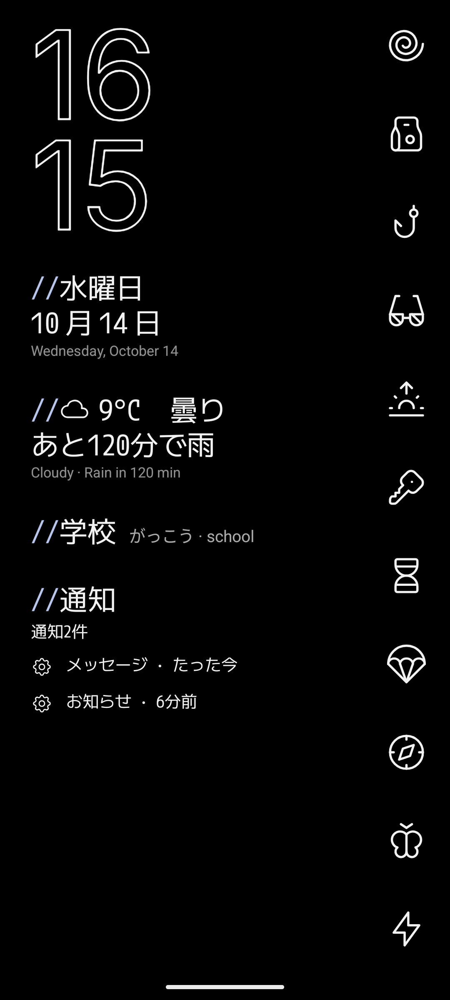
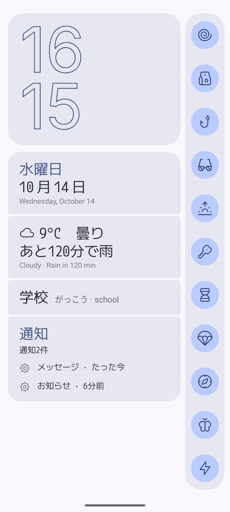
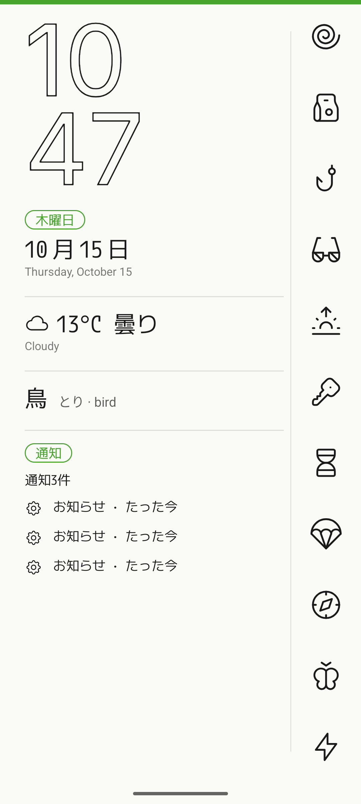
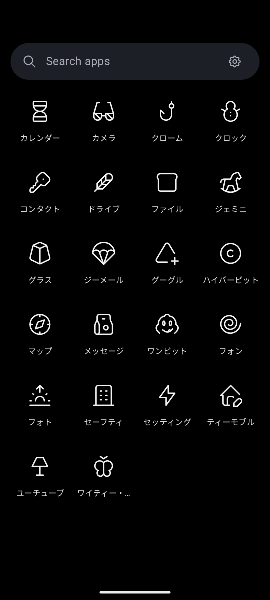

# Kamei Launcher

**A home screen only you can read: written in Japanese, with apps behind symbols only you know.**

Kamei (仮名, "pseudonym", also read "kana") writes everything on your home screen in Japanese, gives each app an unrelated symbol that only hints at it, and can spell app names out in katakana. Hold any line for three seconds to see it in your own language, with its reading. Over time the translations fade, and you're reading Japanese.

<p>




</p>

## Features

- **Private by design.** Apps get unexpected glyphs that hint at them sideways (music → a feather, bank → an anchor), from Tabler's 4,900 line icons; app names can be written as they sound in katakana; notifications show as a short summary until you hold them.
- **Learn as you go.** Small translations under the date and weather, readings in kana or rōmaji, a word of the day, and translations that fade over weeks or every morning; all from a dictionary inside the app, in 15 languages.
- **Weather that matters.** Yr (MET Norway) with radar nowcast, or Open-Meteo: the line turns bluer as rain comes closer and says when it starts or stops. Tap it to open Yr or Drops.
- **Calm warnings.** Battery under 25% turns the line orange, then red, blinking at 5%; weak signal and no service (圏外) the same way.
- **Three themes.** Original (white outlines on black), Material (rounded cards in your wallpaper colours) and Tokyo (paper, ink and tag chips), all following the phone's colours.
- **Yours to arrange.** Clock sizes, layout, offsets and outline; 36 bundled fonts or your own; order of lines; top, middle or bottom; swipe gestures; favourites stack; wallpaper; camera-hole aware.

## Install

- **GitHub:** download `Kamei-Launcher.apk` from the [latest release](https://github.com/AndSni/Kamei-Launcher/releases/latest) and open it
  (allow "install unknown apps"). Then press Home and pick Kamei.
- **F-Droid:** not submitted yet.

Requires Android 8.0 (API 26) or newer.

## Privacy

With weather off, Kamei makes no connections at all. With it on, it asks api.met.no and/or api.open-meteo.com for the forecast at your location rounded to about 1 km; searching for a place sends the typed name to geocoding-api.open-meteo.com. Nothing else, and no identifier, is ever sent. No account, no analytics, no ads, no tracking.

| Permission | Used for |
|---|---|
| Internet | weather only, and only after you switch it on |
| Approximate location | weather where you are, only if you choose that over a fixed place; rounded to about 1 km |
| Expand status bar | swipe down and taps open the notification shade |
| Request delete packages | Uninstall in an app's options |
| Notification access (optional) | counts and summarises waiting notifications; text stays in memory and is never saved or sent |

## Building

```sh
./gradlew :app:assembleDebug        # debug build
./gradlew :app:testDebugUnitTest    # unit tests
```

Release builds are signed by CI from repository secrets; without a `keystore.properties` a
local `assembleRelease` produces an unsigned APK.

## Releasing

1. Bump `versionCode` and `versionName` in `app/build.gradle.kts`; add
   `metadata/en-US/changelogs/<versionCode>.txt`.
2. Commit and push to `main` (CI publishes a rolling `latest` pre-release).
3. Tag that commit `vX.Y.Z` and push the tag: `release-tag.yml` publishes the permanent release
   with `Kamei-Launcher.apk`, the file `.fdroid.yml`'s `Binaries` points at.
4. Pin the tagged commit's full hash in `.fdroid.yml` (`commit:`), bump `CurrentVersion`.

## Credits

- [Tabler Icons](https://tabler.io/icons) 3.31, MIT
- Weather data: [MET Norway](https://api.met.no/) (Yr) and [Open-Meteo](https://open-meteo.com/), CC BY 4.0
- Fonts (SIL OFL 1.1, cut down to the characters the app writes): M PLUS 1 Code, Zen Maru Gothic, DotGothic16, Shippori Mincho, Klee One, Murecho, BIZ UDGothic, Kiwi Maru, Kaisei Decol, Dela Gothic One, Rampart One, Train One, Stick, RocknRoll One, Reggae One, Yusei Magic, Hachi Maru Pop, Potta One, Yuji Syuku, Inter, Space Grotesk, Unbounded, Bebas Neue, Big Shoulders Display, Syne, Instrument Serif, Fraunces, Orbitron, Major Mono Display, Rubik Mono One, Doto, Sixtyfour, Monoton, Bungee Hairline, Tilt Neon, Codystar

## License

GPL-3.0. Copyright © 2026 AndSni. Bundled fonts and icons keep their own licences (texts in
`app/src/main/assets/licenses/`).
